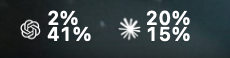
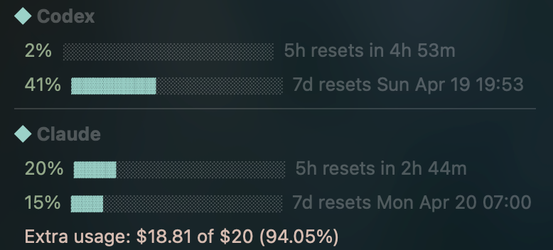

# LLM Usage

Compact macOS menu bar app for Codex, Claude and OpenCode Go usage, shown left to right with stacked `5h` and `7d` percentages. The dropdown also has OpenCode Go's monthly cap.





## Instal## Install

```bash
macapp install    # → /Applications/LLM Usage.app (shared tool, see macapp.conf)
```

`LLM Usage.app` is a small native launcher (`Sources/LLMUsage`) around the Python app.
On launch it syncs a private venv with `uv.lock` (in `~/Library/Application Support/LLM
Usage/venv`, only when the lock changes; needs `uv`), runs `claude_bar.py`, restarts it
after a crash, and stops it when the app quits. It registers itself as a login item
(toggle in System Settings › General › Login Items). Log: `~/Library/Logs/LLM Usage.log`.

Claude Code authentication is used by default, with the browser-cookie fallback.

For development:

```bash
uv sync --frozen --no-dev
.venv/bin/python claude_bar.py            # --browser firefox forces the cookie fallback
```

## Remove

Quit it from its menu, turn it off in Login Items, and delete `/Applications/LLM Usage.app`
(plus `~/Library/Application Support/LLM Usage` for the venv).
ity

- Claude usage is fetched from the authenticated Claude Code CLI's zero-token
  `/usage` command. A local `claude.ai` browser session is retained as a fallback.
- Codex usage is fetched from local Codex auth in `~/.codex/auth.json` or `$CODEX_HOME/auth.json`, with `codex app-server` fallback when needed.
- OpenCode Go usage comes from `https://opencode.ai/zen/go/v1/usage`, using the Go API key from
  `OPENCODE_API_KEY`, Pi's `~/.pi/agent/auth.json`, or OpenCode's `~/.local/share/opencode/auth.json`
  (`opencode-go` entry). Without a key the OpenCode Go section is hidden.
- Credentials stay local and are only used to call Claude/OpenAI/OpenCode endpoints directly.

## Credits

- [`BOUSHABAMohammed/claude-bar`](https://github.com/BOUSHABAMohammed/claude-bar)
- [`steipete/CodexBar`](https://github.com/steipete/CodexBar)
- DeepSeek logo from [`lobehub/lobe-icons`](https://github.com/lobehub/lobe-icons) (MIT)

## License

MIT
